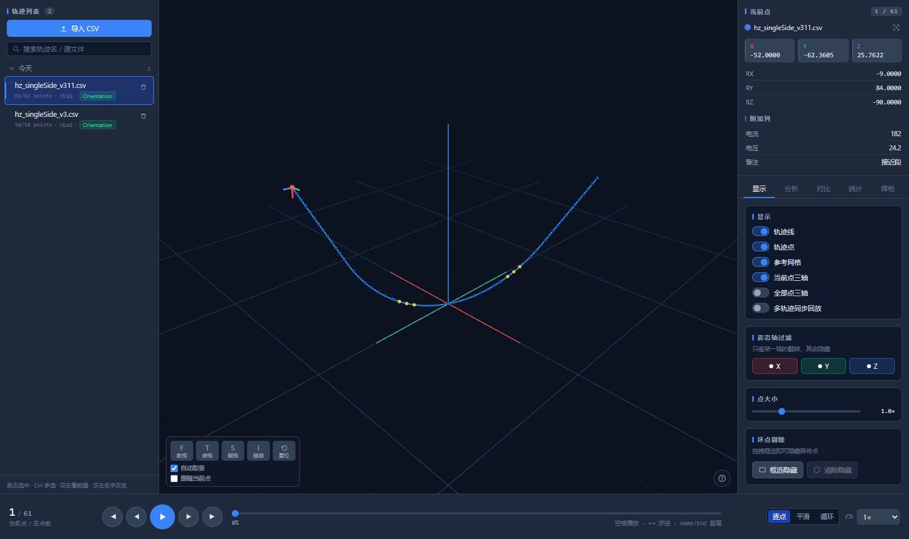
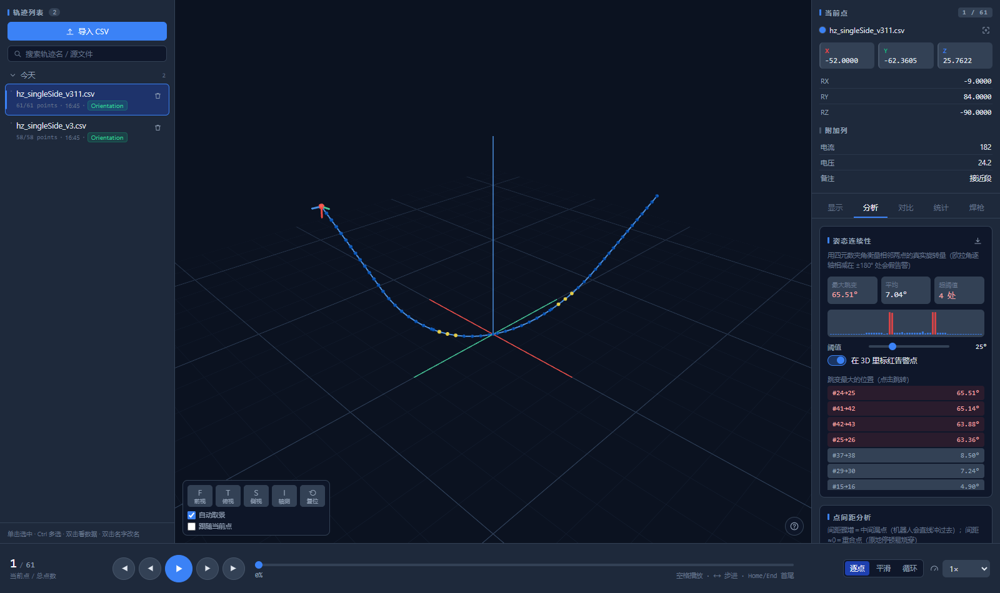
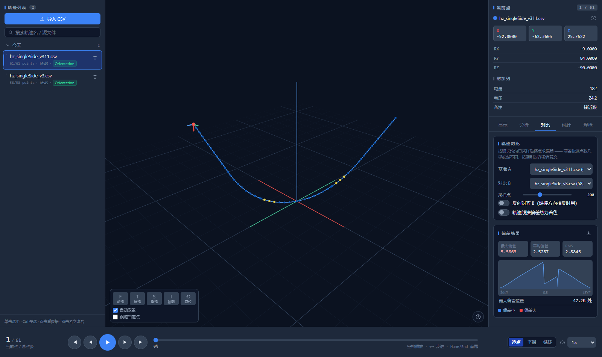
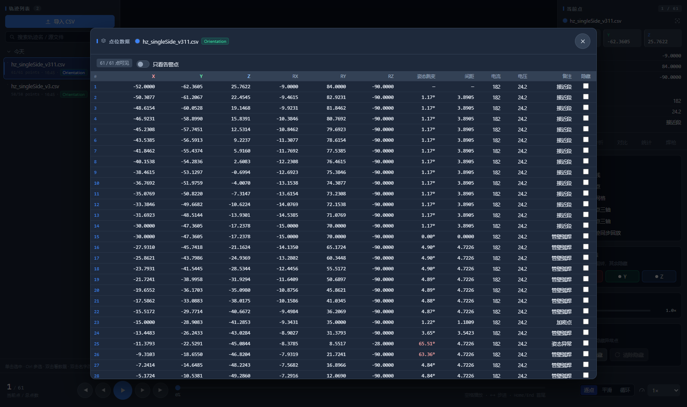
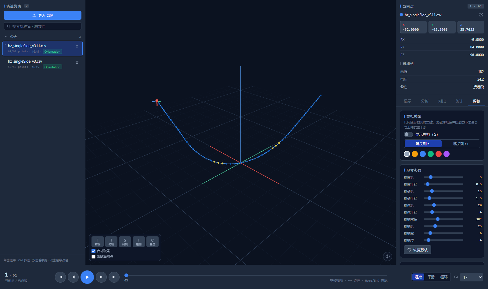

<div align="center">

# PathView

**焊接轨迹三维可视化与校验工作台**

加载 CSV 焊接轨迹 → 三维回放检查 → 姿态/点距/双轨迹对比分析 → 参数化焊枪预览

`React 19` · `TypeScript` · `three.js (@react-three/fiber)` · `Express` · `SQLite`

[快速开始](#-快速开始) · [功能一览](#-功能一览) · [本地启动详解](#-本地启动详解) · [部署到服务器](#-部署到云服务器) · [常见问题](#-常见问题)

</div>

---

## ✨ 功能一览

### 核心功能

| | |
|---|---|
| 📈 **轨迹回放** | 步进 / 平滑 / 跳变三种模式，0.25×–16× 变速，Z 轴向上（焊接机器人约定），多轨迹同步回放 |
| 🧭 **姿态坐标轴** | 当前点 RGB 三轴 + 全部点姿态轴叠加，一眼看出姿态突变 |
| 🖱️ **框选隐藏点** | `B` 进入框选，矩形框内点被剔除，回放 / 测距 / 相机取景自动重算 |
| 📏 **两点测距** | `Shift+点击` 两个点 → ΔXYZ、空间距离、A→B 单位向量，3D 内虚线 + 浮动标签 |
| 🔧 **参数化焊枪** | 10 项几何参数滑杆、内置 / 用户预设、TCP 橙色锥尖标记 |
| 📄 **CSV 两段式导入** | 先预览列映射再入库；GBK / GB18030 / Big5 自动探测；中英文列别名匹配；**无表头自动识别** |
| 📋 **数据表** | 全字段表格 + 姿态跳变角 / 到前点距离列，仅看异常点过滤，逐行隐藏 |

### 分析套件

| | |
|---|---|
| 🧪 **姿态连续性** | 四元数夹角 `2·acos(\|dot\|)` 检测姿态跳变（避免欧拉角 ±180° 误报），阈值可调、点击跳转 |
| 📐 **点距分析** | 中位 / 最大段长、离群点（>3× 中位长）、重复点检测 |
| 🔥 **轨迹 Diff** | A/B 轨迹弧长均匀重采样后逐点偏差，热力着色 + 偏差曲线图 + max/mean/RMS |
| ⏱️ **焊接统计** | 焊缝长度、包围盒、平均转角、急拐点列表，焊接速度滑杆估算节拍 |
| 💾 **干净导出** | 导出当前可见点 CSV（BOM + CRLF，Excel 双击直开），分析报告一键导出 |

## 📸 截图

| 主视图（轴测 + 当前点姿态轴） | 分析面板（姿态跳变检测） |
|---|---|
|  |  |

| 双轨迹 Diff 热力对比 | 数据表（跳变角高亮） | 参数化焊枪 |
|---|---|---|
|  |  |  |

## 🚀 快速开始

### 环境要求

| 依赖 | 版本要求 | 说明 |
|------|----------|------|
| **Node.js** | **≥ 22.13**（推荐 24 LTS） | 用了 Node 内置 `node:sqlite`，低版本启动会给出中文提示 |
| npm | 随 Node | |
| 浏览器 | Chrome / Edge / Firefox 现代版本 | WebGL 2 |

> 为什么不用 better-sqlite3？它在 Windows 上需要 node-gyp + VS Build Tools 原生编译，环境不具备时第一步就卡死。`node:sqlite` 是 Node 22.13+ 内置模块，零原生依赖。

### 三步跑起来

```bash
# 1. 克隆
git clone git@github.com:mzc-keil/PathView.git
cd PathView

# 2. 安装依赖（root / server / client 三层，一次完成）并构建前端
npm run setup

# 3. 启动（二选一）
npm run dev      # 开发模式：前端 5173 热更新 + 后端 3001
npm start        # 生产模式：单端口 3001 托管前端 + API
```

- 开发模式 → 打开 **http://localhost:5173**
- 生产模式 → 打开 **http://localhost:3001**
- 服务监听 `0.0.0.0`，**局域网内同事可直接访问**（启动后终端会打印局域网地址）

> 没有数据也不慌：界面左上「导入 CSV」拖入一份轨迹文件即可（示例列名：`x,y,z,rx,ry,rz`，中文别名如 `X坐标/横坐标/电流/电压` 也能自动匹配，GBK 编码、无表头文件均可）。

## 🖥️ 本地启动详解

### 1. 脚本总览

| 命令 | 作用 |
|------|------|
| `npm run setup` | 首次使用：装三层依赖 + 构建前端，只需跑一次 |
| `npm run install:all` | 只装依赖不构建 |
| `npm run dev` | 开发模式，前后端并行启动（concurrently） |
| `npm run dev:server` | 只启动后端（`node --watch`，改代码自动重启） |
| `npm run dev:client` | 只启动前端（Vite HMR） |
| `npm run build` | 构建前端到 `client/dist` |
| `npm start` | 生产模式启动（要求先 `npm run build`） |
| `npm run typecheck` | 全量 TypeScript 类型检查（`tsc --noEmit`） |

### 2. 开发模式 vs 生产模式

| | 开发 `npm run dev` | 生产 `npm start` |
|---|---|---|
| 访问地址 | http://localhost:**5173** | http://localhost:**3001** |
| 前端改动 | 即时热更新 | 需重新 `npm run build` |
| 后端改动 | `node --watch` 自动重启 | 需重启进程 |
| 原理 | Vite 把 `/api` 代理到 3001 | Express 直接托管 `client/dist`，无跨域 |

日常查看数据用生产模式即可；改代码用开发模式。

### 3. 端口与数据目录（环境变量）

| 变量 | 默认 | 说明 |
|------|------|------|
| `PORT` | `3001` | 监听端口 |
| `PV_DATA_DIR` | `server/data` | SQLite 库与上传暂存目录 |

```bash
# Linux / macOS / Git Bash
PORT=8080 PV_DATA_DIR=/d/pathview-data npm start

# PowerShell
$env:PORT=8080; $env:PV_DATA_DIR="D:\pathview-data"; npm start

# CMD
set PORT=8080 && set PV_DATA_DIR=D:\pathview-data && npm start
```

### 4. 数据放在哪

```
server/data/
  paths.db          SQLite 主库
  paths.db-wal      WAL 预写日志（运行中必然存在，别单独删）
  paths.db-shm      共享内存索引
  uploads/          上传的 CSV 暂存（超过 24 小时自动清理）
```

把整个 `server/data` 目录拷走 = 完整备份。注意 WAL 模式下运行中直接 `cp paths.db` 可能丢最近事务，热备份请用 `sqlite3 paths.db ".backup 'backup.db'"`。

### 5. 首次使用操作路径

1. 打开页面 → 左上「导入 CSV」→ 选择文件
2. 预览页确认列映射（可手动调整、选择表头行、切换编码）→ 确认导入
3. 左侧轨迹列表点击载入 → 三维视图中查看
4. `空格` 播放 / `←` `→` 步进 / `F` `T` `S` `I` 切换前/顶/侧/轴测视图
5. 右侧切换「显示 / 分析 / 对比 / 统计 / 焊枪」五个页签

### 6. 本地排错

| 现象 | 处理 |
|------|------|
| 启动报 `ERR_UNKNOWN_BUILTIN_MODULE: node:sqlite` 或中文版本提示 | Node < 22.13，升级 Node；临时绕过 `NODE_OPTIONS=--experimental-sqlite` |
| 页面白屏 / 404 | 未构建：先 `npm run build` 再 `npm start` |
| 端口被占用 `EADDRINUSE` | 换端口 `PORT=8080 npm start`，或杀掉占用进程 |
| `npm install` 很慢 | `npm config set registry https://registry.npmmirror.com` |
| 三维画面卡顿 | 调低点尺寸、关闭「全部姿态轴」与参考网格，或框选隐藏远处点 |
| 导出 CSV 在 Excel 乱码 | 不会——已带 UTF-8 BOM；WPS 若仍乱码用「数据 → 从文本导入」选 UTF-8 |

## ⌨️ 快捷键

`空格` 播放/暂停 · `←/→` 步进 · `F/T/S/I` 前/顶/侧/轴测视图 · `⟲` 复位 · `B` 框选模式 · `Esc` 退出/清除测距 · `H` 帮助面板 · `1/2/3` 切换右侧页签

（点在三维里被挡住时，先框选隐藏再操作；`Shift+点击` 两个点即测距。）

## 🧱 目录结构

```
├─ server/                 Express + node:sqlite
│  ├─ index.js             入口：API + 静态托管 + SPA fallback
│  ├─ db.js                建表 / WAL / 事务包装（数据目录可用 PV_DATA_DIR 重定向）
│  ├─ csv.js               编码探测 → RFC4180 解析 → 别名匹配 → 表头行识别
│  └─ routes/paths.js      REST 端点
├─ client/                 React 19 + Vite + @react-three/fiber
│  └─ src/
│     ├─ three/            几何 / 相机动画 / 框选 / 分析算法
│     ├─ hooks/            轨迹缓存 / 回放 / 焊枪 / 快捷键
│     ├─ components/       全部 UI 面板与 3D 组件
│     └─ types/            共享 TS 类型
├─ deploy/                 服务器部署资产（Docker / systemd / Nginx / 一键脚本）
├─ docs/screenshots/       README 截图
└─ DEPLOY.md               云服务器部署完整步骤
```

## 🔌 API 一览

| 方法 | 路径 | 说明 |
|------|------|------|
| `GET` | `/api/paths` | 轨迹列表 |
| `POST` | `/api/paths` | 新建轨迹（含点批量插入，事务） |
| `GET` | `/api/paths/:id` | 轨迹详情（含全部点） |
| `PATCH` | `/api/paths/:id` | 改色 / 改名 |
| `DELETE` | `/api/paths/:id` | 删除轨迹 |
| `POST` | `/api/upload-csv` | 上传解析（第一段：预览列映射） |
| `POST` | `/api/paths/:id/reparse` | 重解析已上传文件（第二段：确认写入） |
| `GET` | `/api/health` | 健康检查 |

## ☁️ 部署到云服务器

三种方案（宝塔面板 / **systemd + Nginx + HTTPS** / Docker Compose）、数据备份迁移、
一键发布脚本与安全加固清单，全部在 **[DEPLOY.md](DEPLOY.md)**。

最快路径：

```bash
./deploy/deploy.sh root@你的服务器IP      # 本地构建 → 上传 → 远程构建 → 重启 → 健康检查
```

## ✅ 已验证项

- 8 个 REST 端点 curl 全通过（含非法坐标 warnings、extra 字段持久化、路径穿越拒绝、幂等删除）
- CSV 四场景：GBK+第 4 行表头+引号逗号+CRLF ✅ / UTF-8 BOM ✅ / 无表头 ✅ / 英文别名 ✅
- `tsc` 零错误；Vite 构建 601 模块；生产单进程托管正常
- 浏览器实测：零控制台报错；框选命中验证；两点测距 A=#11 → B=#61 距离 146.5836（勾股校验一致）；Diff max 5.5863 @ 47.29%；姿态分析检出 4 处异常、最大 65.51°

## 📝 说明

- 本项目为 PathView 焊接轨迹工具的**完整功能复刻与增强**，供学习与内部工具用途。
- 相对原设计的关键改进见 `README` 历史版本与 `DEPLOY.md`；核心差异：drei 9→10（React 19 兼容）、better-sqlite3→`node:sqlite`（免原生编译）、逐点 mesh→分层 InstancedMesh（draw call 679→3–6）、smooth 回放真插值、`extra` 字段保留。
